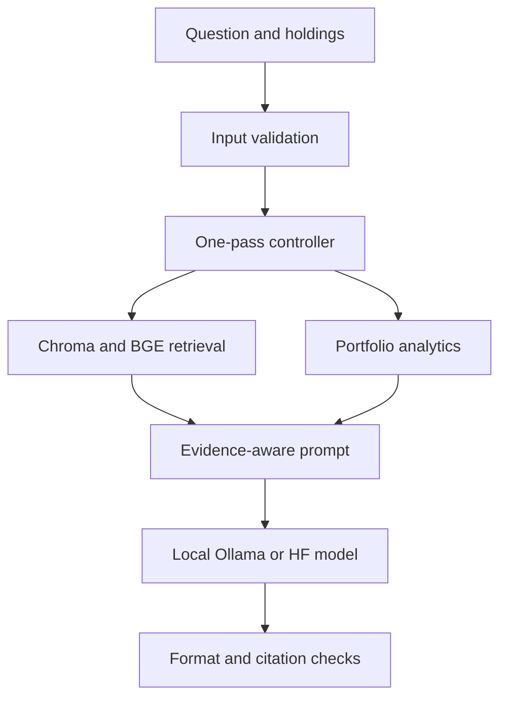

# Architecture

There are two explicit execution paths.

## Live local-model path

run_investment_agent accepts injected retriever, analyzer and generator functions for deterministic tests. Heavy model dependencies load only when needed. Any supplied portfolio is analyzed, regardless of routing keywords.

Retrieval failure is visible in warnings; the prompt asks for Neutral when evidence is insufficient. Generation/provider failures propagate rather than being presented as successful advice. Validation results accompany the raw answer. Invalid output is not rewritten into a passing result.

This is one-pass orchestration, with no autonomous loops, external trading actions or arbitrary code execution. portfolio_memory.py collects interactive input; it does not persist conversation memory.

## Offline walkthrough

src.demo uses the same validated analytics with synthetic metadata and a separate lexical retriever over data/raw. It neither builds a Chroma index nor calls an LLM. app.py exposes this path only. Every export declares uses_llm=false and recommendation=null.

## External boundaries

Live semantic retrieval downloads BGE model weights on first use. Live sector analysis and historical simulation use Yahoo through yfinance. Local generation sends the prompt to OLLAMA_URL, normally localhost; changing it to a remote address also changes where portfolio data is sent.

Inputs and downloaded snippets must be treated as untrusted. Prompt instructions are not a security sandbox. Source-ID checks validate identifier membership, not the truth of associated claims. Do not expose this local demo publicly without authentication, resource limits and an additional deployment review.

## Reproducibility

The offline JSON contains corpus and metadata fingerprints. Simulation uses a local NumPy generator with an explicit seed. Live data can change; live evaluation is a separate opt-in process and its recorded model name alone does not uniquely identify a model digest.
